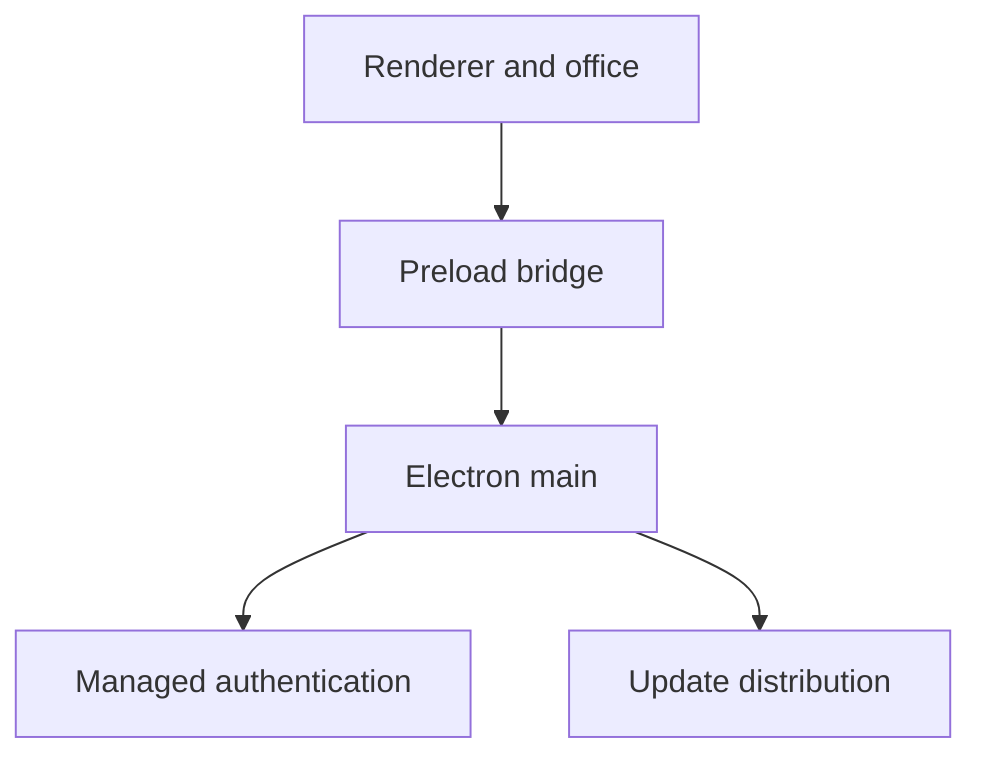
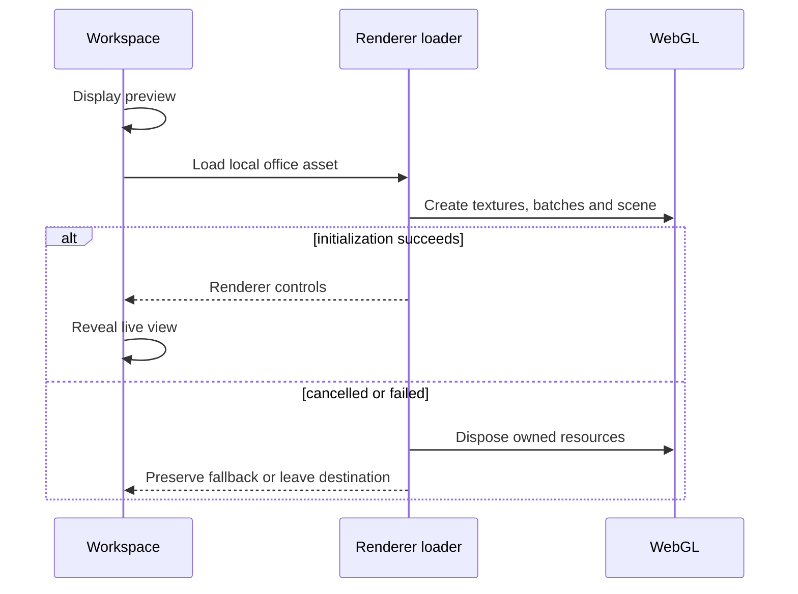

# Architecture and trust boundaries

Owner: maintainer; reviewed against development `022972a` on 2026-11-25.
This describes existing modules, not a proposed microservices rewrite.

| Layer | Canonical responsibility | Boundary |
|---|---|---|
| Desktop main | Immutable ZIP `electron/main.cjs`, auth/identity/update modules; deterministic quality overlays | Privileged OS/auth/update access; validate IPC here |
| Preload | Immutable ZIP `electron/preload.cjs` | Narrow bridge; renderer must not receive private tokens or arbitrary filesystem access |
| Presentation | `assets/agile-office/main.js`, renderer and task panel | DOM, camera and visual lifecycle; no real agent execution |
| Pure policies | `office-performance.mjs`, `office-tasks.mjs` | Scheduling and task validation testable without DOM/network |
| Asset pipeline | `build_scene.py`, `export_glb.py`, KTX2 compressor/verifier | Preserve originals and verify generated geometry/texture semantics |
| Release pipeline | CI/security workflows and candidate/feed verification | Gate results precede promotion; no public source/log upload |

The warm-up/fade improvement is in PR #20, not this baseline. Character and chair state
machines belong to the natural-motion branch; document their exact transitions there rather
than presenting the proposed sequence as development behavior.

## ADR-001: extend existing boundaries

Status: implemented baseline retained. Context: working overlays, pure policies and IPC
already exist. Decision: add focused tests and requirements around those modules rather
than replace them with new frameworks, duplicated flags or microservices. Consequences:
the immutable archive remains a transitional maintainability cost; canonical overlay
provenance must be preserved. Existing architecture gate remains authoritative.

## ADR-002: separate evidence from acceptance

Status: proposed foundation in this PR. Unit-test success verifies a scoped contract;
it does not validate visual fidelity or hardware performance. RTM records verification,
validation and decision status separately. A pass needs a revision and evidence reference;
the validator checks structure/references only. This prevents documents or mocked GPU
results being promoted into unsupported product claims.
